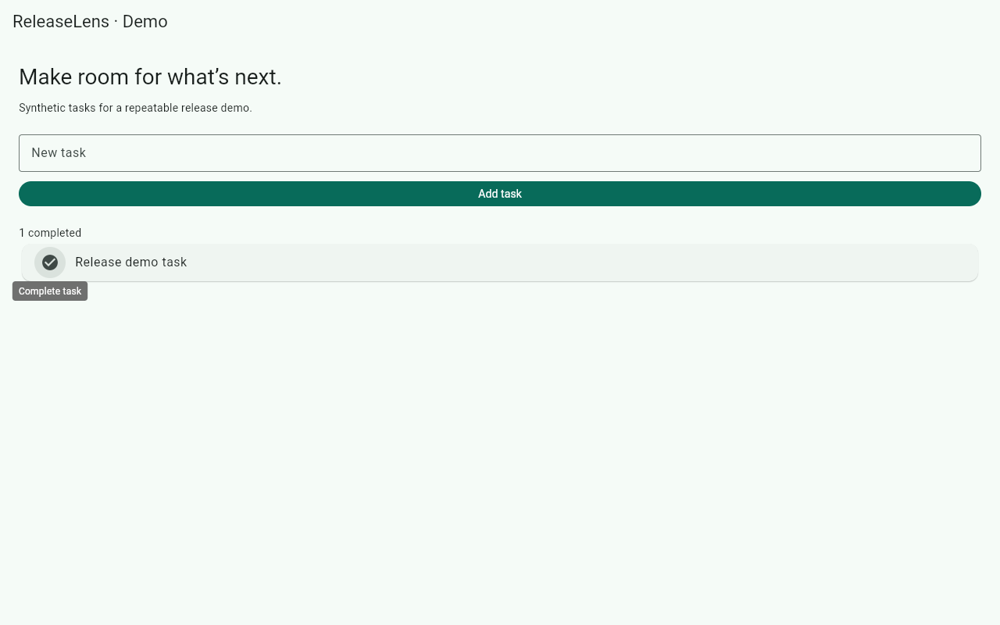

# ReleaseLens user guide

Install [ReleaseLens AI](https://marketplace.visualstudio.com/items?itemName=gyanupadhyay.releaselens-ai) in desktop VS Code and select **Switch to Pre-Release Version**. Open a trusted local project, open ReleaseLens in the activity bar, and choose **Initialize project**. Review the generated configuration and flows before running them. Initialization refuses to overwrite existing files. The extension includes its runtime; you do not need the private implementation repository.

## Tools and first recording

VS Code 1.106+ is required. Install FFmpeg 6+ and ffprobe from your OS package manager or the [FFmpeg download page](https://ffmpeg.org/download.html), then restart VS Code so its PATH includes both executables. Check `ffmpeg -version` and `ffprobe -version` in VS Code's terminal. On macOS `brew install ffmpeg` provides both. On Debian/Ubuntu use `sudo apt-get install ffmpeg espeak`. On Windows add the extracted FFmpeg `bin` directory to your user PATH. Local speech uses Windows System.Speech, macOS `say`, or Linux `espeak`; no cloud account is required. Select silent mode if speech is not installed.

Choose **Set Up Tools**. For web, explicitly approve installing the Chromium revision pinned to Playwright 1.64.1; rerun setup after updating from 0.2.0. Linux may also need Playwright's Chromium host dependencies (see [browser installation](https://playwright.dev/docs/browsers)). Browser and media executables are separate downloads, not included in the extension. Start your app separately; ReleaseLens does not deploy it.

Choose **Plan & generate demo**, select platform, registered scenarios and audio mode. Start with **Registered scenarios (local)**. A successful run opens the video and appears in **Generation history**. The extension logs CLI progress in its output channel. No GitHub token is needed for local recording.

## Configuration

Initialization creates `.releaselens/config.json`, `scenarios.json` and `flows/`. Editor validation and completion are included. Example for a normal web app:

```json
{
  "schemaVersion": 1,
  "platform": "web",
  "registry": ".releaselens/scenarios.json",
  "outputDir": "artifacts",
  "web": {
    "baseUrl": "http://127.0.0.1:4173",
    "allowedOrigins": ["http://127.0.0.1:4173"],
    "allowedPaths": ["/"],
    "selectorEngine": "test-id",
    "width": 1280,
    "height": 800
  },
  "narration": {"provider": "system"},
  "video": {"captions": true, "fps": 30},
  "timeoutSeconds": 120
}
```

`platform` is `web` or `flutter-android`. For Android add `android: {"apkPath":"build/app/outputs/flutter-apk/app-debug.apk","appId":"com.example.your_app","device":"emulator-5554"}`. Build the single APK and boot the emulator first. Update the Maestro flow's `appId` too. Android requires adb, Java 17+ and Maestro 2.11.0. Portable Windows Maestro is supported by setting `RELEASELENS_MAESTRO_HOME` to its extracted directory containing `lib`, with `java` on PATH before launching VS Code. Use [official Maestro installation](https://docs.maestro.dev/getting-started/installing-maestro). The adapter never automatically builds, boots, or wipes an emulator. The example flow's **`clearState: true` clears the selected app's data**: use a disposable test identity and edit that command if inappropriate.

`registry`, `outputDir`, script paths and optional `web.storageState` must be project-relative without traversal or symlink escapes. Timeout is 10–170 seconds per scenario; split longer demos. Width/height are 320–1920; video fps is 15–60. `narration.provider` is `system` or `none`; `video.captions` controls the subtitle track. Optional `github: {"repository":"owner/repo","baseBranch":"main"}` enables PR analysis. Optional `web.releasePath: "/version"` enables verified web builds; return JSON `{"commitSha":"<full deployed SHA>"}`.

Web steps are `goto`, `fill`, `click` and `assert`. Normal HTML uses stable `data-testid` attributes. The registry is an array, for example:

```json
[{"id":"create-task","title":"Create a task","platform":"web","tags":["task"],"script":".releaselens/flows/task.json","prerequisites":["Start the test app"],"assertions":["Release demo task"]}]
```

The referenced flow:

```json
[
  {"action":"goto","path":"/"},
  {"action":"fill","testId":"task-input","value":"Release demo task"},
  {"action":"click","testId":"add-task"},
  {"action":"assert","testId":"task-list","text":"Release demo task","narration":"The new task appears in the list."}
]
```

Every registry assertion must appear in its flow. Narration starts only after the assertion is observed. Prerequisites are review notes; they are not executed as shell commands. Android flows are trusted Maestro YAML with direct mandatory `assertVisible` commands matching the registry assertions. Review all Maestro commands; those flows can modify the test application.

## Flutter web

Set `web.selectorEngine` to `flutter-semantics`. Add stable `Semantics(identifier: 'task-input', child: ...)` identifiers around controls and assertion regions. Enable accessibility semantics in the test build and keep its `SemanticsHandle` alive (see [Flutter accessibility](https://docs.flutter.dev/ui/accessibility/web-accessibility)). ReleaseLens reads `flt-semantics-identifier` nodes and accessible assertion text; it does not click canvas coordinates. IDs must be unique for the current page. Host Flutter renderer assets locally, for example build with `flutter build web --release --no-web-resources-cdn`; otherwise deliberately allow every external asset origin. The included acceptance sample uses a release CanvasKit build, not an HTML stand-in. Other Flutter versions/renderers need project-specific acceptance before use.

A captured assertion from the real Flutter acceptance sample (synthetic data):



## Network, authentication and trust

Allow only the target origins and required assets/API paths. `/` allows every route on an allowed origin; `/demo/` permits that subtree; `/login` permits exactly that path. **HTTP redirects fail closed** in this release, including redirects between allowed URLs. Configure the final URL; avoid redirecting authentication flows. Service workers, downloads and extra windows are blocked. WebSockets use the same origin/path policy. Allowlists are a guardrail for reviewed apps, not a sandbox for hostile websites or Maestro scripts.

For authenticated web demos, create a Playwright storage-state file using a dedicated test account and set `web.storageState` to its relative path. Keep it out of Git and shared artifacts; it contains reusable cookies/tokens. ReleaseLens does not automate an interactive login or generate storage state. Use synthetic records: videos and screenshots can contain everything visible in the app.

**Set GitHub Token** stores a token in VS Code SecretStorage; submit an empty value to remove it. For private repositories use a fine-grained token limited to the selected repository with read access to Contents, Pull requests, Deployments, Checks and Actions as needed. No write or Marketplace-publishing permission is needed for recording. CI uses its scoped `GITHUB_TOKEN`; never commit a PAT. Media, browser, adb and Maestro children receive an environment stripped of known integration and publishing credentials. Custom CLI/Node paths are machine-level settings and execute trusted local programs.

## Deployment verification

PR or commit-range selection analyzes changes and is labeled unverified. It never proves deployment. Choose **Verified deployment receipt**, select a project-local receipt, then review scenarios. Generation checks GitHub's deployment/status/smoke check and the actual running web SHA or installed APK. See [CI setup](CI_SETUP.md) for receipt production and Android build/artifact attestation. A local caller cannot mark a run verified by supplying a SHA or APK hash alone.

## Outputs and recovery

Each run writes to `outputDir/<run-id>/`: `manifest.json`, scenario recordings, assertion screenshots/Maestro reports, logs, narration, `timeline.json`, captions and a successful `release.mp4`. Captions are a selectable MP4 subtitle track, **not burned into pixels**; enable subtitles in your player. VS Code playback depends on its codecs; open the file externally if necessary. Failed/cancelled runs retain diagnostics and are never reported successful. Partial output is opt-in in the CLI, retains partial status, and exits nonzero. Review all artifacts before sharing. Delete an old run's directory when it is no longer needed; no automatic retention or cloud upload is performed.

Cancel in the progress notification or sidebar; cleanup stops only the owned recorder/process tree. A per-project lock and a per-user emulator lease prevent overlapping runs. After a crash, close any orphaned recorder deliberately, wait at least 30 seconds for the coordinator/device lease to become stale, then choose **Recover interrupted runs**. Recovery refuses an active project process and preserves failed diagnostics. The old `recovery.lock` file no longer blocks recovery. Do not delete live locks or use a shared user-state directory to bypass device ownership.

For problems include extension/VS Code/OS/tool versions, selected platform, and redacted logs in [support issues](https://github.com/gyanupadhyay/releaselens-support/issues). Never attach tokens, auth state or private customer recordings. Security reports follow [SECURITY.md](https://github.com/gyanupadhyay/releaselens-support/blob/main/SECURITY.md).

## Supported scope and pending platforms

| Area | Release scope |
| --- | --- |
| Desktop hosts | Windows x64, Linux x64 and macOS Intel: CLI/media/system speech and real VS Code packaged-host checks |
| Android | Local x86_64 emulator, single APK, Maestro 2.11.0; full end-to-end acceptance on Windows |
| Web | Pinned Chromium; HTML test IDs; Flutter semantics with a real Windows CanvasKit sample |
| Pending | iOS, physical devices/device farms, split APKs, Flutter desktop, Firefox/WebKit, VS Code browser extension, ARM host acceptance |
| Cloud | AI planning and ElevenLabs disabled; deterministic matching and local speech available |

This is a public pre-release for the listed configurations. It is not a claim of production certification for every app, OS/device combination or hostile input. The implementation repository remains private; the public repository contains documentation, support and release binaries.
